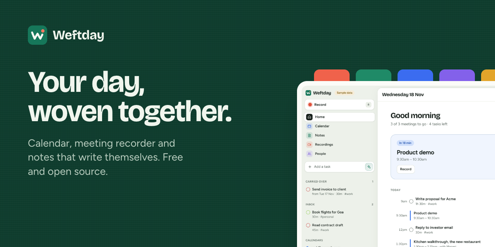
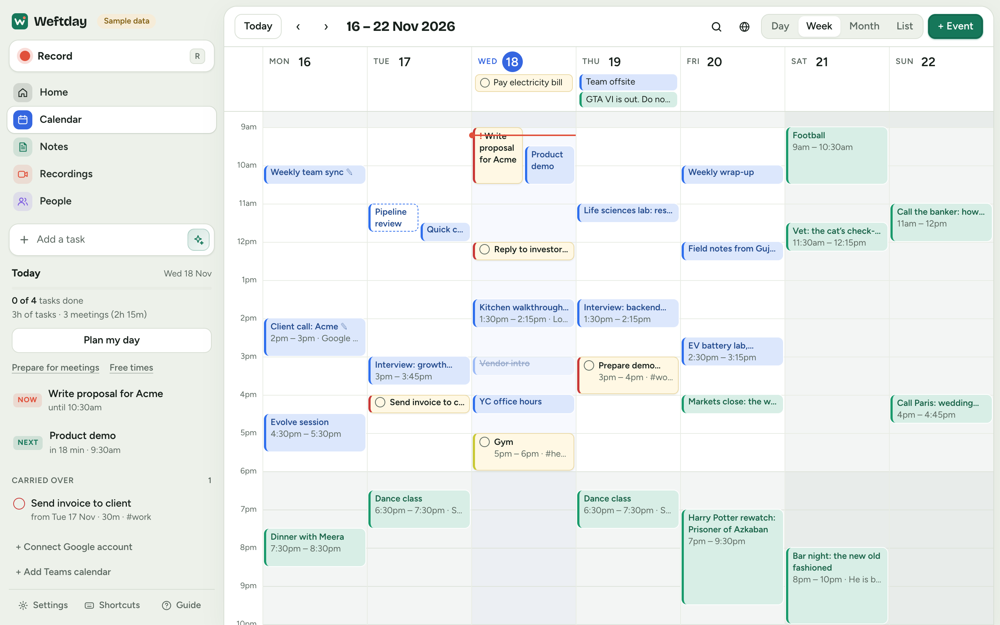
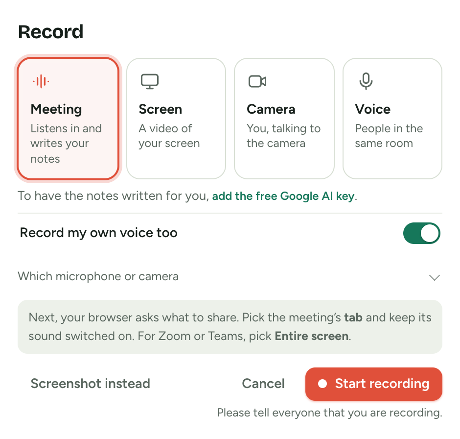
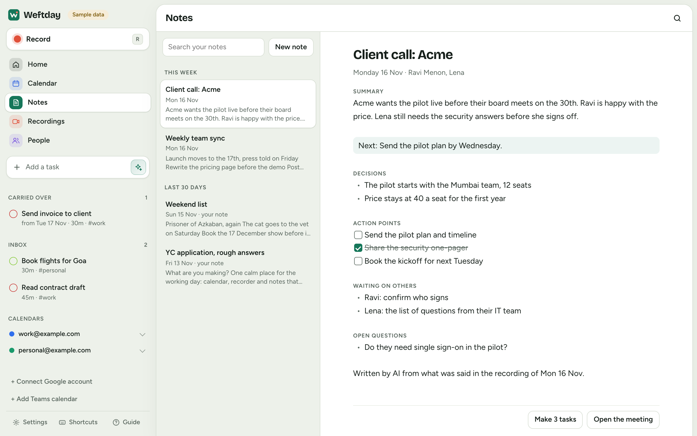

<p align="center">
  <a href="https://app.weftday.crckd.live/?demo"></a>
</p>

<p align="center">
  <a href="https://weftday.crckd.live/">Website</a> ·
  <a href="https://app.weftday.crckd.live/">Open the app</a> ·
  <a href="https://app.weftday.crckd.live/?demo">Try it with sample data</a> ·
  <a href="https://app.weftday.crckd.live/guide.html">Guide</a> ·
  <a href="docs/README.md">Docs</a>
</p>

<p align="center">
  <a href="https://github.com/crckdteam/weftday/actions/workflows/checks.yml"></a>
  <a href="LICENSE"></a>
  
  
</p>

Weftday is one calm place for the working day: every Google calendar, and your tasks, together, a
recorder for meetings and the screen, and notes that are written for you from the recording. You
walk into a meeting prepared, and walk out with the notes and next steps already written.

You can look around without signing in to anything.
[Open it with sample data](https://app.weftday.crckd.live/?demo).

## What it does

### Every calendar in one day

Connect several Google accounts and see every calendar in one view. Add tasks and place them as time
blocks next to your meetings. A company Teams or Outlook calendar can be shown too (view only),
through a [small helper](public/helpers/README.md) that runs in your own Google account.

<picture>
  <source media="(prefers-color-scheme: dark)" srcset="docs/img/calendar-dark.png">
  
</picture>

### A recorder with four modes

| Mode | What it does |
|---|---|
| **Meeting** | Listens in and writes your notes. No bot joins the call. |
| **Screen** | A video of your screen with its sound. |
| **Camera** | You, talking to the camera. |
| **Voice** | For people in the same room. |

It also takes single screenshots. Recordings are kept in your browser.

<p align="center">
  
</p>

### Notes that write themselves

After a recording, Weftday writes down what was said, with who spoke and when. Then it writes the
notes: a summary, the decisions, the action points, what you are waiting on from others, and the
open questions. Each action point can become a task. This uses an AI key you get yourself, and
Google's is free.

<picture>
  <source media="(prefers-color-scheme: dark)" srcset="docs/img/notes-dark.png">
  
</picture>

### And around the meeting

- **Ask your meetings.** Ask about the note in front of you, about one recording, or one question
  across all of them. A follow-up email is written from the note, for you to read before it opens
  in Gmail.
- **People and company pages.** A page for each person you meet and their company, with your
  history together and, if you choose, facts gathered from the web.
- **Share links through your own Google Drive.** A share link puts a copy of one recording in a
  folder in your Drive. You can switch the link off again.

Weftday also works offline once it has been opened, and can be installed to a home screen.

## Why it is different

- **The day is one thread.** The meeting on your calendar, the recording of it, the notes from it
  and the tasks that follow sit together.
- **Yours stays yours.** Everything is kept in your browser or in your own Google account. Weftday
  has no server, no accounts of its own and no analytics.
- **Free to run.** No paid tiers. AI features use a key you get yourself, and Google's is free.
- **Open and simple.** Plain HTML, CSS and JavaScript. No build step and nothing to install. You
  can read the code and host your own copy.

### Where your things are kept

| What | Where |
|---|---|
| Tasks, settings, notes, sign-in tokens and AI keys | Your browser (`localStorage`) |
| Recordings and screenshots | Your browser (IndexedDB) |
| Tasks and notes, if you choose | Also a calendar called "Weftday" in your own Google account, so your other devices can show them |
| Connected accounts and keys, if you switch on the same accounts on every device | Also one encrypted entry in that "Weftday" calendar |
| A recording you share | A copy in a folder in your own Google Drive, until you stop sharing |

Your browser talks straight to Google and to any AI service you add. Nothing passes through a
server run by Weftday, because there is none. Nothing goes to an AI until you add your own key. From
then on, looking up the guests in today's meetings is on unless you switch it off in Settings → AI;
everything else is sent only when you press a button, or switch on a setting, that says so. No
analytics, no advertising, no tracking.

The full detail is in [docs/privacy-and-security.md](docs/privacy-and-security.md) and in the
[privacy policy](https://app.weftday.crckd.live/privacy.html).

## Run it yourself

You need [Node.js](https://nodejs.org) only for the small local server. The app itself needs
nothing.

```bash
git clone https://github.com/crckdteam/weftday.git
cd weftday
node serve.mjs
```

Then open http://localhost:4321. Add `?demo` to the address for sample data.

To host your own copy, put the `public/` folder on any static host. There is nothing to build. The
steps are in [docs/self-hosting.md](docs/self-hosting.md).

## Set up Google sign-in

The published app is invite-only for now: anyone can look around, and connecting a calendar asks
for an invite (by WhatsApp or email, from the "Request access" box). An invite link brings the
sign-in setup with it, so the person invited only connects their own Google account.

On your own copy, you create your own Google Cloud client once (about ten minutes) and paste its
Client ID and Client secret into **Settings → Advanced**. The app shows the steps there, and they
are written out in [docs/self-hosting.md](docs/self-hosting.md#2-create-a-google-cloud-client).
Your own copy never asks for an invite. To use it on your phone too, open **Settings → Accounts →
Use Weftday on my phone too** and scan the square.

The sample data needs none of this.

## How it is built

Weftday is a folder of static files. The browser loads `public/index.html`, which loads plain
JavaScript modules, and those talk straight to Google and to any AI service you have added.

```
public/    the app: plain HTML, CSS and JavaScript modules, served as it is
site/      the website (a separate static folder)
legacy/    the one page left at the app's old address, which moves saved things to the new one
test/      logic tests and the browser check
tools/     check, secrets check and publish scripts
docs/      how it is built, self-hosting, publishing, privacy and security
serve.mjs  a tiny local web server with no dependencies
```

The checks:

```bash
sh tools/check.sh quick    # every script file reads as valid code, then the logic tests
sh tools/check.sh          # the same, then the real app in Chrome with sample data
sh tools/secrets.sh        # nothing key-shaped in the files
```

The first and the last run by themselves on every push to `main` and every pull request (the
**Checks** badge at the top). The browser check uses Python's Playwright and the Chrome already on your computer;
[CONTRIBUTING.md](CONTRIBUTING.md#run-the-checks) says how to switch it on.

More in [docs/architecture.md](docs/architecture.md): the files, where data lives, sign-in, the
recorder, and how notes are written.

## Status and known limits

Weftday is young and changes often. The published app is always the latest version;
a numbered release marks a point worth naming, and [CHANGELOG.md](CHANGELOG.md) lists what changed,
day by day.

These limits are real today:

- **Google sign-in needs your own Google Cloud client.** One shared, Google-approved app is
  planned, so that connecting an account becomes a single press. Until then Google shows a "not
  verified" warning when you connect, which is expected for a private client.
- **Recording needs Chrome or Edge on a computer.** Recording a screen, a tab or a meeting's sound
  is not possible on a phone. A phone can record your voice or your camera, not a call.
- **A shared "Entire screen" ends if the computer's display goes to sleep.** Weftday asks the
  browser to keep the screen awake while it records, but the system can still override that.
- **Recordings live only in the browser you made them in.** They are not copied to your other
  devices. Download the ones you want to keep; clearing the browser's data removes them.
- **AI can get things wrong.** It can mishear, leave things out or state something that was never
  said. Read the notes before you rely on them.
- **Share links need the Google Drive API** switched on in your Google Cloud project.
- **There is no Mac or Windows app yet.** Weftday lives in a browser tab.

## Contributing

Changes are welcome. Read [CONTRIBUTING.md](CONTRIBUTING.md) first; it is short. Everyone taking
part is expected to follow the [Code of Conduct](CODE_OF_CONDUCT.md).

- Something is broken: [report a problem](https://github.com/crckdteam/weftday/issues/new?template=bug_report.yml).
- You have an idea: [suggest a feature](https://github.com/crckdteam/weftday/issues/new?template=feature_request.yml).

## Security

Please do not report a security problem in a public issue. Use GitHub's private vulnerability
reporting: **Security → Report a vulnerability** on the repository. See [SECURITY.md](SECURITY.md).

## Licence

Copyright (C) 2026 CRCKD

Weftday is free software under the [GNU Affero General Public License, version 3](LICENSE)
(AGPL-3.0). You may use, study, change and share it under those terms. If you run a changed copy
for other people, you must offer them your source code.

- The fonts in `public/fonts` (Figtree and Bricolage Grotesque) are used under the SIL Open Font
  License 1.1. See [public/fonts/OFL.txt](public/fonts/OFL.txt).
- `public/vendor/anthropic-sdk.js` is the official Anthropic SDK for JavaScript, bundled into one
  file, under the Apache License 2.0. See [public/vendor/README.md](public/vendor/README.md).
- The recorder was written from scratch. Ideas were studied from [Cap](https://github.com/CapSoftware/Cap);
  no code was copied.

Weftday is an independent project. It is not made by, or connected with, Google.

<p align="center">
  <a href="https://weftday.crckd.live/"></a><br>
  Weftday is a <a href="https://www.crckd.live">CRCKD</a> product.
</p>
